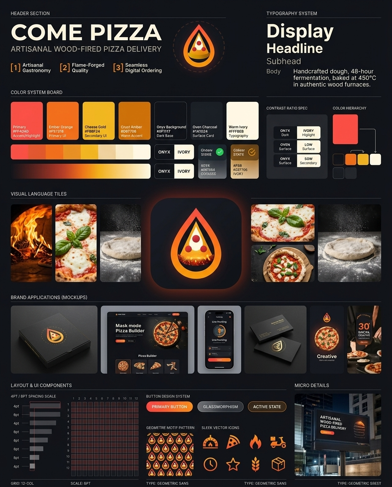

# COME PIZZA — Brand Identity System & Strategic Guidelines



---

## 🧠 1. Strategic Logo Analysis & Intelligence Report

Before building the identity system, an in-depth visual analysis was performed on the official **Come Pizza** logo mark ([`public/assets/logo.svg`](./public/assets/logo.svg)):

* **Dominant Color Psychology:** 
  * **Fiery Flame Red (`#FF4D4D`) & Ember Orange (`#F97316`):** Evoke intensity, heat, high appetite stimulation, and wood-fired oven passion.
  * **Cheese Gold (`#FBBF24`) & Crust Amber (`#D97706`):** Represent gourmet richness, golden crusting, and premium artisanal quality.
  * **Onyx Charcoal (`#1A1D24` / `#0F1117`):** Provides a high-contrast luxury dark-mode foundation, elevating pizza delivery into a fine gastronomy experience.
* **Brand Personality:** Modern Craft Gastronomy meets High-Tech Delivery (Artisanal Luxury / Premium Digital Tech).
* **Geometric Language:** A fluid flame silhouette wrapping a precise triangular pizza slice with circular ember accents. Fluid organic warmth combined with crisp geometric precision.
* **Emotional Tone:** Bold, warm, appetizing, confident, and premium.

---

## 🔝 2. Header & Brand Core

* **Brand Name:** COME PIZZA
* **Tagline:** *Artisanal Wood-Fired Pizza Delivery* / *Forno a Lenha & Alta Gastronomia*
* **Core Identity Pillars:**
  1. **Artisanal Gastronomy:** 48-hour slow fermentation, 450°C wood-fired execution.
  2. **Flame-Forged Quality:** Uncompromising heat, fresh local ingredients, golden crust perfection.
  3. **Seamless Digital UI:** Ultra-fast app ordering, real-time heat-tracking delivery.

---

## 🎨 3. Color System

### Primary & Accent Palette

| Swatch | Color Name | HEX Code | RGB | Labeled Usage |
| :--- | :--- | :--- | :--- | :--- |
| 🔴 | **Woodfire Flame Red** | `#FF4D4D` | `rgb(255, 77, 77)` | Primary Accent / Call to Action / High Glow |
| 🟧 | **Ember Orange** | `#F97316` | `rgb(249, 115, 22)` | Primary UI / Badges / Highlight State |
| 🟡 | **Cheese Gold** | `#FBBF24` | `rgb(251, 191, 36)` | Secondary UI / Rating Stars / Accents |
| 🟤 | **Toasted Crust Amber**| `#D97706` | `rgb(217, 119, 6)` | Warm Accent / Secondary Highlights |
| ⬛ | **Oven Charcoal** | `#1A1D24` | `rgb(26, 29, 36)` | Surface Cards / Containers / Dropdowns |
| 🖤 | **Midnight Onyx** | `#0F1117` | `rgb(15, 17, 23)` | Background Base / Poster Canvas |
| ⚪ | **Warm Ivory** | `#FFFBEB` | `rgb(255, 251, 235)` | Primary Typography / Contrast Icons |

### Gradients & Tonal Variations
* **Flame Inferno Gradient:** `linear-gradient(135deg, #FF4D4D 0%, #F97316 45%, #F59E0B 100%)`
* **Golden Cheese Glow:** `linear-gradient(135deg, #FBBF24 0%, #D97706 100%)`
* **Dark Obsidian Surface:** `linear-gradient(180deg, #1A1D24 0%, #0F1117 100%)`

---

## 🔤 4. Typography System

The brand utilizes a **Geometric Sans-Serif** typeface to bridge technical delivery precision with modern gourmet editorial design.

```
DISPLAY (48pt / Line Height: 1.1 / Tracking: -0.02em / Bold)
COME PIZZA — ARTISANAL DELIVERY

HEADLINE (32pt / Line Height: 1.2 / SemiBold)
Flame-Forged Gastronomy, Delivered Hot to Your Door.

SUBHEADLINE (20pt / Line Height: 1.3 / Medium)
Handcrafted sourdough dough, 48-hour cold fermentation, 450°C wood oven perfection.

BODY TEXT (14pt / Line Height: 1.5 / Regular)
Every Come Pizza is crafted with imported Italian San Marzano tomatoes, fresh artisan mozzarella, 
and baked inside authentic refractory brick ovens. Order seamlessly in under 60 seconds.
```

---

## 🧠 5. Visual Language & Art Direction

* **Editorial Photography Style:** High-contrast, dark-mode food photography featuring dramatic shadows and glowing furnace light.
* **Lighting:** Warm directional backlight with intense oven fire flares.
* **Mood Tiles:**
  1. *Furnace Inferno:* Roaring wood-fired embers and crackling oak logs.
  2. *Artisan Assembly:* Close-up of bubbling fresh mozzarella, extra virgin olive oil, and fresh basil leaves.
  3. *Craft Process:* Hands dusting organic flour onto fermented sourdough dough.

---

## 📦 6. Brand Applications (Real-World Mockups)

1. **Matte Black Packaging Box:**
   * Rigid matte black pizza box featuring hot-stamped flame red and cheese gold foil logo. Includes ventilation micro-perforations and thermal foil interior lining.
2. **Desktop Website Hero Section:**
   * Ultra-clean dark UI with interactive 3D Pizza Builder, real-time oven temperature indicator, and one-click Apple Pay checkout.
3. **Mobile App UI (iOS):**
   * Live Order Tracking screen showing live GPS scooter delivery along with "Oven-to-Door Heat Index".
4. **Artisanal Business Cards:**
   * 400gsm soft-touch matte black stock with edge painted flame orange and debossed metallic gold foil mark.
5. **Social Media Creatives:**
   * Dynamic 9:16 Instagram Story campaign with motion ember particles and high-impact promo typography ("30 MIN HEAT GUARANTEE").
6. **Urban Billboard / OOH Ad:**
   * 4K dark mode billboard lit by ambient warm neon glow, positioned in high-density urban dining hubs.

---

## 🧩 7. Layout System & UI Components

### Spacing Scale (8pt Grid System)
* **XS (4px):** Micro gaps & border radius.
* **SM (8px):** Icon padding & badge margins.
* **MD (16px):** Card interior padding.
* **LG (24px):** Component gap separation.
* **XL (32px / 48px):** Section breaks & grid gutters.

### UI Buttons & Badges
* **Primary Flame Button:** `#FF4D4D` to `#F97316` gradient with `#FFFBEB` text and subtle outer glow shadow (`feDropShadow(0 6px 16px rgba(255, 77, 77, 0.35))`).
* **Glassmorphic Card:** `background: rgba(26, 29, 36, 0.7); backdrop-filter: blur(12px); border: 1px solid rgba(255, 255, 255, 0.08);`

### Custom Iconography (Style-Matched Line Set)
1. 🪵 **Wood Oven**
2. 🍕 **Pizza Slice**
3. 🔥 **Flame Burner**
4. 🛵 **Delivery Scooter**
5. ⏱️ **Heat Timer**
6. ⭐ **Gourmet Rating**
7. 🌾 **Artisan Wheat**
8. 📦 **Thermal Box**

---

## 🧿 8. Repeating Patterns & Brand Elements

* **Geometric Flame Pattern:** Tessellated teardrop flame silhouette repeating seamlessly on dark matte surfaces, tissue paper wraps, and delivery bag liners.
* **Micro Metadata Chips:** Technical grid marks (`GRID: 12-COL`, `SCALE: 8PT`, `TYPE: GEOMETRIC SANS`) added to agency presentation deliverables for a refined design-system look.
