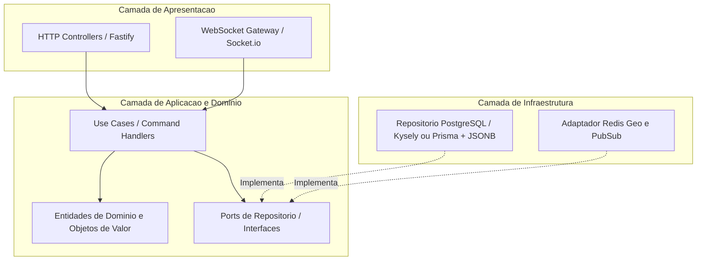
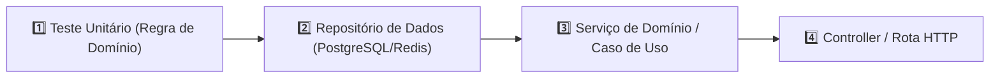

# COME PIZZA — Plano de Implementação Técnica

## 🎯 Descrição do Objetivo
Este documento estabelece o plano de engenharia full-stack para o **COME PIZZA** (Plataforma D2C de Delivery de Pizza Artesanal no Forno a Lenha), construído sobre a arquitetura decidida na Fase 2: **PostgreSQL + JSONB** (armazenamento transacional ACID + pedidos polimórficos em JSON) e **Redis** (rastreamento geoespacial, cache de sessão e streaming Pub/Sub WebSocket).

---

## 🏗️ 1. Organização Arquitetural

O projeto será organizado utilizando **Vertical Slice Architecture** combinada com **Ports & Adapters (Arquitetura Hexagonal)** dentro de cada fatia de domínio. Isso garante o isolamento das regras de negócio mantendo fronteiras claras entre as camadas HTTP, WebSockets e Banco de Dados.



### Estrutura de Diretórios do Projeto

```text
src/
├── modules/
│   ├── orders/
│   │   ├── domain/
│   │   │   ├── order.entity.ts
│   │   │   ├── order-item.value-object.ts
│   │   │   └── order-status.enum.ts
│   │   ├── application/
│   │   │   ├── dtos/
│   │   │   │   └── create-order.dto.ts
│   │   │   ├── ports/
│   │   │   │   └── order-repository.port.ts
│   │   │   └── use-cases/
│   │   │       ├── create-order.use-case.ts
│   │   │       └── update-order-status.use-case.ts
│   │   ├── infrastructure/
│   │   │   ├── postgres-order.repository.ts
│   │   │   └── order.schema.ts
│   │   └── presentation/
│   │       ├── order.controller.ts
│   │       └── order.routes.ts
│   ├── tracking/
│   │   ├── domain/
│   │   │   └── courier-position.value-object.ts
│   │   ├── application/
│   │   │   ├── ports/
│   │   │   │   └── tracking-repository.port.ts
│   │   │   └── use-cases/
│   │   │       ├── update-courier-location.use-case.ts
│   │   │       └── stream-courier-location.use-case.ts
│   │   ├── infrastructure/
│   │   │   └── redis-tracking.repository.ts
│   │   └── presentation/
│   │       └── tracking.gateway.ts
│   └── catalog/
│       └── ...
└── shared/
    ├── domain/
    │   ├── aggregate-root.ts
    │   └── result.ts
    └── infrastructure/
        ├── database/
        └── redis/
```

---

## 📝 2. Contratos TypeScript & DTOs (Zod)

### Enums e Objetos de Valor do Domínio

```typescript
// src/modules/orders/domain/order-status.enum.ts
export enum OrderStatus {
  CREATED = 'CREATED',
  CONFIRMED = 'CONFIRMED',
  IN_PREPARATION = 'IN_PREPARATION',
  BAKING = 'BAKING', // Específico da fila do forno a lenha
  OUT_FOR_DELIVERY = 'OUT_FOR_DELIVERY',
  DELIVERED = 'DELIVERED',
  CANCELLED = 'CANCELLED'
}

export type CrustType = 'TRADITIONAL' | 'STUFFED_CHEESE' | 'CHARRED_HERB';
export type PizzaSize = 'INDIVIDUAL_25CM' | 'MEDIUM_30CM' | 'LARGE_35CM';

export interface PizzaFlavorSelection {
  flavorId: string;
  name: string;
  fraction: 0.5 | 1.0; // Suporte a meio-a-meio
}

export interface PizzaCustomization {
  size: PizzaSize;
  crust: CrustType;
  flavors: PizzaFlavorSelection[]; // 1 ou 2 sabores
  extraToppings: Array<{
    toppingId: string;
    name: string;
    priceCents: number;
  }>;
  removedIngredients: string[]; // ex: "sem cebola"
}

export interface OrderItem {
  id: string;
  productId: string;
  productName: string;
  quantity: number;
  unitPriceCents: number;
  customization?: PizzaCustomization;
}

export interface CustomerInfo {
  id: string;
  name: string;
  phone: string;
  deliveryAddress: {
    street: string;
    number: string;
    complement?: string;
    neighborhood: string;
    city: string;
    zipCode: string;
    coordinates?: {
      lat: number;
      lng: number;
    };
  };
}

export interface Order {
  id: string;
  code: string; // Código público amigável (ex: #CP-8492)
  customerId: string;
  customerInfo: CustomerInfo;
  items: OrderItem[];
  status: OrderStatus;
  subtotalCents: number;
  deliveryFeeCents: number;
  totalCents: number;
  paymentMethod: 'PIX' | 'CREDIT_CARD' | 'CARD_ON_DELIVERY';
  paymentStatus: 'PENDING' | 'PAID' | 'FAILED' | 'REFUNDED';
  courierId?: string;
  createdAt: Date;
  updatedAt: Date;
}
```

### DTOs de Validação com Zod

```typescript
import { z } from 'zod';

export const CreateOrderDTOSchema = z.object({
  customerId: z.string().uuid(),
  customerInfo: z.object({
    name: z.string().min(2),
    phone: z.string().min(10),
    deliveryAddress: z.object({
      street: z.string(),
      number: z.string(),
      complement: z.string().optional(),
      neighborhood: z.string(),
      city: z.string(),
      zipCode: z.string(),
      coordinates: z.object({
        lat: z.number(),
        lng: z.number()
      }).optional()
    })
  }),
  items: z.array(z.object({
    productId: z.string().uuid(),
    quantity: z.number().int().positive(),
    customization: z.object({
      size: z.enum(['INDIVIDUAL_25CM', 'MEDIUM_30CM', 'LARGE_35CM']),
      crust: z.enum(['TRADITIONAL', 'STUFFED_CHEESE', 'CHARRED_HERB']),
      flavors: z.array(z.object({
        flavorId: z.string().uuid(),
        name: z.string(),
        fraction: z.union([z.literal(0.5), z.literal(1.0)])
      })).min(1).max(2),
      extraToppings: z.array(z.object({
        toppingId: z.string().uuid(),
        name: z.string(),
        priceCents: z.number().int().nonnegative()
      })),
      removedIngredients: z.array(z.string())
    }).optional()
  })).min(1),
  paymentMethod: z.enum(['PIX', 'CREDIT_CARD', 'CARD_ON_DELIVERY'])
});

export type CreateOrderDTO = z.infer<typeof CreateOrderDTOSchema>;
```

### DTO de Rastreamento GPS do Entregador

```typescript
export interface CourierLocationUpdate {
  courierId: string;
  orderId: string;
  latitude: number;
  longitude: number;
  heading?: number;
  speedMs?: number;
  timestamp: number;
}
```

---

## 🧪 3. Sequência Estrita de Implementação TDD

A execução segue o ciclo de 4 etapas para cada funcionalidade:



### Fase 1: Domínio Principal e Entidades
- **1.1 Teste Unitário:** `OrderEntity.test.ts` — Cálculo do valor total do pedido com sabores meio-a-meio, adicionais e transição de status (`CREATED` -> `BAKING` -> `OUT_FOR_DELIVERY`).
- **1.2 Implementação:** Classe de domínio `order.entity.ts` com validação de invariantes.

### Fase 2: Camada de Persistência de Dados (Ports & Adapters)
- **2.1 Teste de Integração:** `PostgresOrderRepository.spec.ts` — Mapeamento de escrita/leitura do JSONB no PostgreSQL e transações ACID.
- **2.2 Teste de Integração:** `RedisTrackingRepository.spec.ts` — Escrita/leitura de latência no Redis com `GEOADD` e `GEORADIUS`.
- **2.3 Implementação:** Repositórios concretos `postgres-order.repository.ts` e `redis-tracking.repository.ts`.

### Fase 3: Casos de Uso da Aplicação
- **3.1 Teste Unitário:** `CreateOrderUseCase.test.ts` — Mocks de repositório, validação de disponibilidade de estoque e geração de código amigável.
- **3.2 Teste Unitário:** `UpdateCourierLocationUseCase.test.ts` — Teste de atualização GPS e envio via pub/sub.
- **3.3 Implementação:** Serviços de aplicação concretos.

### Fase 4: Camada de Apresentação (Controllers & WebSockets)
- **4.1 Teste E2E da API:** `OrderRoutes.e2e.spec.ts` — Validação das rotas HTTP POST `/orders`, formação de resposta e códigos de erro (400, 422, 500).
- **4.2 Teste WebSocket:** `TrackingGateway.e2e.spec.ts` — Conexão de socket, emissão de `update_location` e transmissão via broadcast.
- **4.3 Implementação:** Rotas Fastify e gateways Socket.io.

---

## ✅ 4. Critérios de Aceitação Objetivos

| Componente | Critério Objetivo de Aceitação | Estratégia de Verificação |
| :--- | :--- | :--- |
| **Lógica de Domínio** | 100% de cobertura nos testes de preço da pizza, cálculo de meio-a-meio e rejeição de transições de status inválidas. | `pnpm --filter @come-pizza/backend test` |
| **Armazenamento JSONB** | Estado completo do pedido (incluindo toppings e sabores fracionados) persistido e recuperado sem perda de dados. | `pnpm --filter @come-pizza/backend test` (PostgreSQL) |
| **Latência de GPS** | Operação no Redis `GEOADD` + broadcast Pub/Sub concluída em menos de 15ms. | Script de benchmark |
| **Validação da API** | Payloads inválidos rejeitados com esquema de erro Zod 400 detalhado. | `pnpm --filter @come-pizza/backend test` |
| **Concorrência** | Pedidos simultâneos não geram condições de corrida (*race conditions*) no estoque de massas. | Script de teste de carga (`k6` / artillery) |
