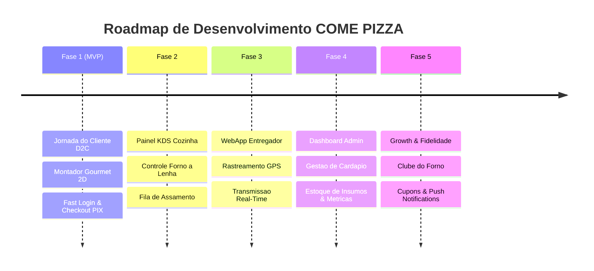

# 🍕 COME PIZZA — Roadmap de Desenvolvimento do Produto

## 🎯 Visão Geral do Produto
O **COME PIZZA** é uma plataforma D2C (Direct-to-Consumer) de delivery de pizza artesanal no forno a lenha, focada em alta gastronomia, experiência interativa de montagem de pizzas e rastreamento em tempo real do pedido à entrega.

---

## 📌 Visão Geral das Fases

---

## 🚀 FASE 1: MVP — Jornada do Cliente D2C (Foco Total em Conversão)

### 1.1 Autenticação Sem Atrito (Fast Login)
- [ ] Login social de um clique (Google e Apple).
- [ ] Autenticação por código OTP de 4 dígitos via WhatsApp / SMS (sem senhas).
- [ ] Fluxo de visitante: navegação livre no cardápio antes de autenticar.

### 1.2 Cardápio Digital Interativo
- [ ] Categorias de produtos: Pizzas Artesanais, Bebidas, Sobremesas, Entradas.
- [ ] Filtros por restrições (Vegetariano, Sem Lactose, Mais Pedidos).
- [ ] Busca instantânea por ingredientes e nomes.

### 1.3 Montador de Pizzas Gourmet (Customizer 2D)
- [ ] **Seleção de Tamanho:** Brotinho (25cm), Média (30cm), Grande (35cm).
- [ ] **Seleção de Sabores:** 1 Sabor ou Meio-a-Meio (cobrança pelo sabor de maior valor).
- [ ] **Visualizador 2D:** Renderização gráfica em tempo real da pizza dividida com adicionais.
- [ ] **Tipos de Borda:** Tradicional, Catupiry, Cheddar, Ervas Tostadas.
- [ ] **Ingredientes Extras Dinâmicos:** Adição com cálculo de preço em tempo real (+Bacon, +Burrata, +Mel Silvestre).
- [ ] **Preferência do Forno a Lenha:** Nível de assamento (Massa clássica vs Levemente mais assada/tostada).
- [ ] **Remoção de Ingredientes:** Opção de retirar itens (ex: "Sem cebola").

### 1.4 Checkout & Pagamento
- [ ] Cadastro rápido de endereço de entrega com busca de CEP e geolocalização.
- [ ] Pagamento instantâneo via PIX com suporte a QR Code e Copia e Cola.
- [ ] Pagamento em cartão de crédito online ou na entrega (maquininha).
- [ ] Validação de cupom de desconto inicial.

### 1.5 Rastreamento de Pedido em Tempo Real
- [ ] Linha do tempo visual do status: `Criado` ➔ `Confirmado` ➔ `Em Preparação` ➔ `No Forno` ➔ `Saiu para Entrega` ➔ `Entregue`.
- [ ] Estimativa dinâmica de tempo de chegada.

---

## 👨‍🍳 FASE 2: Operação Interna — Painel KDS da Cozinha (Kitchen Display System)

### 2.1 Gestão da Fila do Forno a Lenha
- [ ] Tela touchscreen otimizada para monitores de cozinha (Modo Escuro / Alto Contraste).
- [ ] Cartões de pedidos coloridos por tempo de espera (Verde ➔ Amarelo ➔ Vermelho).
- [ ] Detalhamento claro de adicionais, remoções e nível de assamento do forno.

### 2.2 Controle de Etapas da Cozinha
- [ ] Avançar status com um toque: `Abrindo Massa` ➔ `Montando` ➔ `Forno a Lenha` ➔ `Pronto p/ Despacho`.
- [ ] Alertas sonoros para novos pedidos recebidos.
- [ ] Cronômetro de ocupação de lastro do forno a lenha.

---

## 🛵 FASE 3: Logística — WebApp do Entregador & Rastreamento GPS

### 3.1 Painel do Entregador
- [ ] WebApp PWA responsivo para dispositivos móveis dos motoboys.
- [ ] Aceite de corridas e rota de entrega otimizada via Google Maps / Waze.
- [ ] Atualização de status de entrega (`Retirei o Pedido` ➔ `Cheguei ao Endereço` ➔ `Entregue`).

### 3.2 Streaming de Geolocalização (Redis + WebSockets)
- [ ] Transmissão contínua da coordenada GPS do entregador a cada 3-5 segundos.
- [ ] Exibição do ícone da moto se deslocando ao vivo no mapa do aplicativo do cliente.

---

## 📊 FASE 4: Gestão & Métricas — Dashboard Administrativo

### 4.1 Gestão de Cardápio & Estoque
- [ ] CRUD dinâmico de produtos, sabores, massas, bordas e preços.
- [ ] Controle de estoque de massa em tempo real (ex: marcar sabor como esgotado na noite).
- [ ] Pausa temporária no recebimento de novos pedidos em dias de pico.

### 4.2 Métricas Operacionais & Financeiras
- [ ] Relatórios de faturamento diário, semanal e mensal.
- [ ] Tempo médio de preparação x tempo médio de entrega.
- [ ] Ranking dos sabores de pizza mais vendidos.

---

## 🎁 FASE 5: Growth, Fidelidade & Engajamento

### 5.1 "Clube do Forno" (Programa de Fidelidade)
- [ ] Acúmulo de pontos a cada pizza comprada (100 pontos = 1 Pizza Média Grátis).
- [ ] Badges e conquistas (ex: "Amante de Pepperoni", "Mestre do Forno").

### 5.2 Marketing Dinâmico
- [ ] Disparo automatizado de mensagens no WhatsApp para clientes inativos após 15 dias.
- [ ] Cupons temporizados de desconto (ex: "Pizza de Terça com 20% OFF").
- [ ] Notificações Push no navegador/celular.

---

## 🧪 Estratégia de Qualidade & Testes (TDD)
- **Backend:** Testes unitários de domínio com Vitest em todas as regras de negócio de preço, status e geolocalização.
- **Frontend:** Testes de componentes com Vitest e React Testing Library no montador de pizzas.
- **Integração:** Testes E2E de rotas da API com banco PostgreSQL e Redis.
